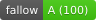
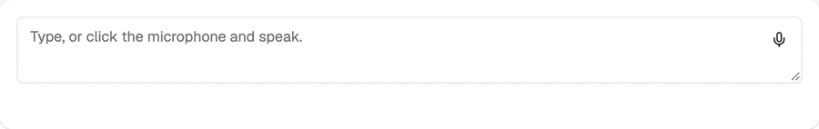

<p align="center">
  <a href="https://github.com/sponsors/niekes"></a>
</p>

<p align="center">
  <strong>Local AI components for <a href="https://ui.shadcn.com">shadcn/ui</a>.</strong><br>
  The model runs in the browser: nothing leaves the machine, and there is no server to pay for.<br>
  Free and open source, kept alive by one maintainer and the people who sponsor the work.
</p>

<p align="center">
  <a href="https://github.com/niekes/browser-ai/actions/workflows/main.yml"></a>
  <a href="https://github.com/niekes/browser-ai/actions/workflows/main.yml"></a>
  <a href="https://fallow.tools/docs/explanations/health/"></a>
  <a href="https://ui.shadcn.com/docs/registry"></a>
  <a href="https://www.npmjs.com/package/parakeet.js"></a>
  <a href="https://github.com/niekes/browser-ai/blob/main/LICENSE"></a>
  
  <a href="https://github.com/niekes/browser-ai"></a>
  <a href="https://github.com/sponsors/niekes"></a>
</p>

<p align="center">
  <a href="https://niekes.github.io/browser-ai/docs">Docs</a> ·
  <a href="https://niekes.github.io/browser-ai/docs/installation">Installation</a> ·
  <a href="https://niekes.github.io/browser-ai/docs/components">Components</a> ·
  <a href="https://niekes.github.io/browser-ai/docs/how-it-works">How it works</a>
</p>

---

<table>
    <tr style="background-color: #f6f8fa">
        <td><a target="_blank" href="https://niekes.github.io/browser-ai/docs/components/speech-input"><picture><source media="(prefers-color-scheme: dark)" srcset="assets/examples/speech-input-dark.gif"></picture></a></td>
    </tr>
</table>

A textarea that takes dictation: the words show at the cursor while you talk, and the final text lands there when you stop. [Parakeet TDT 0.6B v3](https://huggingface.co/nvidia/parakeet-tdt-0.6b-v3) runs on the GPU through WebGPU, in desktop browsers with 16-bit floats: Chrome, Edge, Firefox and Safari. The model is about 1.3 GB: it downloads once the reader confirms it, and stays in the browser.

## Sponsor browser-ai

**browser-ai** is free, and it always will be. There is no company behind it — just one maintainer working in spare time — so the cost of keeping it alive is paid for by the people who depend on it.

If browser-ai saves you time, [become a sponsor](https://github.com/sponsors/niekes).

| Tier        | What you get                                                                                |
| ----------- | ------------------------------------------------------------------------------------------- |
| **$5/mo**   | Your name in the [sponsors list](#sponsors) and my sincere thanks                           |
| **$25/mo**  | The above, plus your logo in the README and on the docs site, and priority issue triage     |
| **$100/mo** | The above, plus direct email access for feature requests and a mention in the release notes |

Where the money goes:

- **Issue triage and bug fixes.** Sponsorship buys a reply within a couple of days instead of whenever I get to it.
- **Components that keep up.** Keeping the registry in step with shadcn/ui, React, Tailwind CSS, WebGPU and the models.
- **The documentation site.** Hosting, builds and the live examples.
- **Time for new work.** More local AI components, and faster inference on more devices.

Prefer a one-off? The [sponsor page](https://github.com/sponsors/niekes) also takes one-time contributions.

**Need a company sponsorship or an invoice?** [Get in touch](mailto:s@niekes.com).

## Sponsors

Thank you to the people who make this possible. Sponsors at $25/mo and above get their logo in this README and on the docs site; everyone gets their name below.

<!-- New sponsors go below this line, one per line. -->

## Using browser-ai

```bash
npx shadcn@latest add niekes/browser-ai/speech-input        # the textarea that takes dictation
npx shadcn@latest add niekes/browser-ai/use-speech-to-text  # the hook behind it, for a UI of your own
```

Everything else lives in the [documentation](https://niekes.github.io/browser-ai/docs): [installation](https://niekes.github.io/browser-ai/docs/installation), the [components](https://niekes.github.io/browser-ai/docs/components) and [how it works](https://niekes.github.io/browser-ai/docs/how-it-works). For an AI assistant, [llms.txt](https://niekes.github.io/browser-ai/llms.txt) lists every page and [llms-full.txt](https://niekes.github.io/browser-ai/llms-full.txt) holds them all.

browser-ai is not affiliated with shadcn/ui.

## Licenses

The code is [BSD-3-Clause](LICENSE). The model is NVIDIA's, licensed under [CC-BY-4.0](https://creativecommons.org/licenses/by/4.0/): credit it on a page that uses it. parakeet.js is MIT. See [NOTICE](NOTICE).

## Contributing

See [CONTRIBUTING.md](CONTRIBUTING.md).

## Star History

[](https://www.star-history.com/#niekes/browser-ai&type=date&legend=bottom-right)
